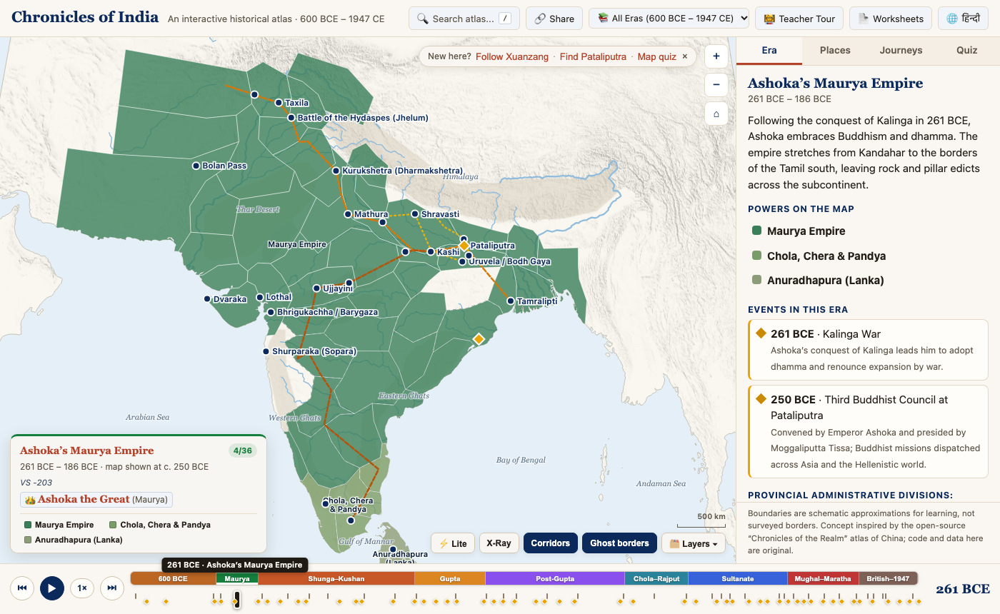

# भारत के इतिहास का मानचित्र (Chronicles of India)

<p align="left">
  <a href="README.md">English</a> · <strong>हिन्दी (Hindi)</strong> · <a href="docs/ACCURACY.md">ऐतिहासिक सटीकता</a> · <a href="docs/SOURCES.md">स्रोत</a> · <a href="docs/GOOD-FIRST-ISSUES.md">योगदान (Issues)</a>
</p>

**भारतीय उपमहाद्वीप का एक संवादात्मक ऐतिहासिक एटलस (600 ईसा पूर्व – 1947 ईस्वी) — 2,500+ वर्षों के इतिहास में समयरेखा घुमाएं, प्राचीन नगरों की वंशावली देखें और यात्रियों के पदचिह्नों पर चलें।**

<p align="left">
  
  
  
  
  
  
</p>

> ⚠️ **मानचित्र पर दिखाई गई सीमाएँ सीखने के लिए योजनाबद्ध अनुमान (schematic approximations) हैं, न कि सर्वेक्षण की गई कानूनी सीमाएँ।**
> अधिक जानकारी के लिए [docs/ACCURACY.md](docs/ACCURACY.md) और [docs/SOURCES.md](docs/SOURCES.md) देखें।

<p align="center">
  
</p>

---

## इसे देखना इतना रोचक क्यों है?

भारतीय इतिहास, साहित्य या NCERT / UPSC की तैयारी करते समय क्या आपने कभी सोचा है:
- *"आज के मानचित्र पर **पाटलिपुत्र** कैसे **पटना** बना, **ढिल्लिका** कैसे **शाहजहाँनाबाद** से **नई दिल्ली** में बदली, या **प्रतिष्ठान** और **कांचीपुरम** किस साम्राज्य के केंद्र थे?"*
- *"भारतीय उपमहाद्वीप का मानचित्र चरण-दर-चरण कैसे बदला — **16 महाजनपद (600 ई.पू.)**, **अशोक का मौर्य साम्राज्य**, **गुप्त स्वर्ण युग**, **चोल नौसैनिक शक्ति**, **दिल्ली सल्तनत**, **विजयनगर** और **मुग़ल–मराठा** काल से लेकर **1947 स्वतंत्रता और एकीकरण** तक?"*
- ***ह्वेन त्सांग (629–645 ईस्वी)** नालंदा किस मार्ग से पहुंचे, **इब्न बतूता** ने सल्तनत में कहाँ-कहाँ यात्रा की, या **महात्मा गांधी की दांडी यात्रा** का मार्ग क्या था?*

**Chronicles of India** एक ही बिना-बिल्ड (zero-build) इंटरैक्टिव एटलस में **36 ऐतिहासिक युग**, **रंगीन समयरेखा (`0.3×` से `2×` गति)**, **सीमा परिवर्तन (Ghost Borders)**, **82 प्रमुख घटनाएँ**, **क्षेत्रीय लिपियों सहित 92 नगर**, **26 यात्री वृत्तांत**, **NCERT/UPSC परीक्षा मोड** और **पूर्ण हिन्दी / English समर्थन** प्रदान करता है।

---

## मुख्य विशेषताएँ

### 1. रंगीन समयरेखा, प्लेबैक गति और सीमा परिवर्तन
- **36 ऐतिहासिक युग (600 ई.पू. – 1947 ईस्वी)**: रंगीन युग पट्टियों (*महाजनपद, मौर्य, शुंग–कुषाण, गुप्त, गुप्तोत्तर, चोल–राजपूत, सल्तनत, मुग़ल–मराठा, ब्रिटिश–1947*) पर क्लिक करें या स्लाइडर खींचें।
- **प्लेबैक गति नियंत्रण**: **`0.3×`**, **`0.5×`**, **`1×`**, **`1.5×`** और **`2×`** गति से इतिहास देखें (`Space` से चलाएं/रोकें)।
- **बिंदीदार सीमा परिवर्तन (Ghost Borders)**: पिछले युग से बदले हुए भूभाग तुरंत पहचानें।
- **शासक और भारतीय संवत**: **विक्रम संवत (VS)**, **शक संवत**, **हिजरी (AH)** और **कोल्लम संवत (ME)** के साथ सक्रिय शासक और प्रांतीय विभाग देखें।

### 2. व्यवस्थित मानचित्र परतें (Layers) और वास्तविक भूगोल
- **परतें मेनू (`🗂️ परतें`)**: **ऐतिहासिक परतें** (*साम्राज्य, प्रांतीय विभाग, प्राचीन स्थान, व्यापार मार्ग, सीमा परिवर्तन, प्रमुख घटनाएं*) और **भूगोल व आधुनिक संदर्भ** (*भू-आकृति व पर्वत, नदियां व झीलें, आधुनिक सीमाएं, आधुनिक नाम*) अलग-अलग चालू/बंद करें।
- **वास्तविक भूगोल**: Natural Earth तटरेखा, 115 द्वीप, 36 नदियाँ, 7 पर्वत/मरुस्थल, SRTM/ETOPO1 पहाड़ी छाया और 60 गैर-अतिव्यापी क्षेत्र।
- **लाइट मोड (`⚡ लाइट मोड`)**: कमज़ोर उपकरणों के लिए एक-क्लिक प्रदर्शन मोड।

### 3. प्रमुख घटनाएँ और 92 नगरों की वंशावली
- **82 प्रमुख घटनाएँ**: मानचित्र और समयरेखा पर क्लिक करने योग्य हीरे (`◆`) चिह्न, जिनसे घटना विवरण और निकटवर्ती ऐतिहासिक नगर खुलते हैं।
- **स्थान नामावली**: 92 नगरों के सदियों पुराने नाम और **देवनागरी, तमिल, कन्नड़, तेलुगु, मलयालम, बंगाली, मराठी, उड़िया, गुरुमुखी** लिपियों में मूल नाम देखें।

### 4. 26 यात्राएँ, मार्ग तुलना और खोज
- **26 यात्री एवं अभियान**: अलेक्जेंडर, फाह्यान, ह्वेन त्सांग, आदि शंकराचार्य, इब्न बतूता, गुरु नानक, शिवाजी, रानी लक्ष्मीबाई और महात्मा गांधी के मार्गों की तुलना करें।
- **यूनिवर्सल खोज (`/` या `Cmd/Ctrl + K`)**: स्थान, शासक, युग, घटना, यात्री या क्विज़ तुरंत खोजें।

### 5. NCERT / UPSC परीक्षा मोड, शिक्षक दौरा और क्विज़
- **पाठ्यक्रम फ़िल्टर और अध्ययन केंद्र**: **NCERT कक्षा 6–12** और **UPSC** फ़िल्टर, **प्रिंट योग्य पुनरावलोकन पत्रक** और **उत्तर कुंजी सहित रिक्त अभ्यास मानचित्र**।
- **शिक्षक दौरा मोड**: कक्षा शिक्षण बिंदु, परिचर्चा प्रश्न और आवाज़ वाचन।
- **4 प्रश्नोत्तरी मोड**: *स्थान खोजें (Pinpoint Quiz)*, *राजधानी सुमेलन*, *कालक्रम व्यवस्था* और *शासक एवं काल*।

---

## कीबोर्ड शॉर्टकट और डीप लिंक

| कुंजी | कार्य |
| :--- | :--- |
| **`/`** या **`Cmd/Ctrl + K`** | **यूनिवर्सल खोज** खोलें |
| **`Space`** | समयरेखा चलाएं / रोकें |
| **`←` / `→`** | पिछला / अगला युग (`Shift + ← / →` से 10 वर्ष आगे/पीछे) |
| **`L`** | भाषा बदलें (**English ↔ हिन्दी**) |
| **`X`** | आधुनिक सीमाएं (X-Ray) चालू/बंद करें |
| **`C`** | व्यापार व तीर्थ मार्ग चालू/बंद करें |
| **`G`** | सीमा परिवर्तन (Ghost Borders) चालू/बंद करें |
| **`1` / `2` / `3` / `4`** | पैनल टैब बदलें (**युग / स्थान / यात्राएं / प्रश्नोत्तरी**) |

---

## कैसे चलाएँ

कोई बिल्ड स्टेप या बाहरी लाइब्रेरी नहीं चाहिए:

```bash
git clone https://github.com/mendax-iitm/chronicles-of-india.git
cd chronicles-of-india
python3 -m http.server 8000   # फिर http://localhost:8000 खोलें
```

या Docker के साथ चलाएँ:

```bash
docker compose up -d
```

---

## लाइसेंस और श्रेय

- **कोड**: [MIT License](LICENSE)
- **`data/` में ऐतिहासिक डेटा और विवरण**: CC BY 4.0
- **आधार भूगोल**: [Natural Earth](https://www.naturalearthdata.com/) (Public Domain)
- **प्रेरणा**: [Chronicles of the Realm (`jiangshan-map`)](https://github.com/DeanChensj/jiangshan-map) — केवल वैचारिक प्रेरणा; सभी कोड और डेटा मौलिक हैं।
