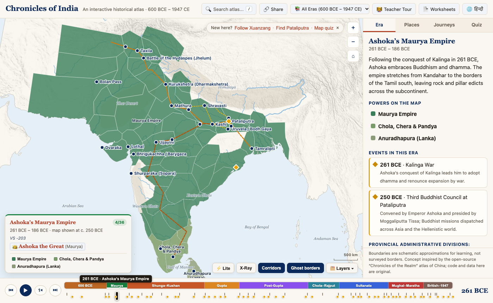

# Chronicles of India · भारत का ऐतिहासिक एटलस

<p align="left">
  <strong>English</strong> · <a href="README.hi.md">हिन्दी (Hindi)</a> · <a href="docs/ACCURACY.md">Historical Accuracy</a> · <a href="docs/SOURCES.md">Sources</a> · <a href="docs/GOOD-FIRST-ISSUES.md">Good First Issues</a>
</p>

**An Interactive Historical Atlas of the Indian Subcontinent (600 BCE – 1947 CE) — Scrub Through 2,500+ Years of History, Trace Ancient Cities, and Walk in the Footsteps of Travellers & Empires.**

<p align="left">
  
  
  
  
  
  
  
</p>

> ⚠️ **Boundaries are schematic approximations for learning, not surveyed borders.**
> Empires had frontiers, not lines. See [docs/ACCURACY.md](docs/ACCURACY.md), [docs/SOURCES.md](docs/SOURCES.md), and [BRIEF.md](BRIEF.md#10-editorial-policy--read-this-carefully).

<p align="center">
  
</p>

---

## Why It's Fun to Explore

Have you ever wondered while reading Indian history, classical literature, or preparing for NCERT / UPSC:
- *"Where exactly on today's map did **Pataliputra** become **Patna**, **Dhillika** evolve through **Shahjahanabad** into **New Delhi**, or **Pratishthana** and **Kanchipuram** anchor their empires?"*
- *"How did the subcontinent's map transform step by step — from the **16 Mahajanapadas (600 BCE)**, **Ashoka's Mauryan Empire**, **Gupta Golden Age**, **Chola maritime zenith**, **Delhi Sultanate**, **Vijayanagara**, and **Mughal–Maratha** rivalry, to **1947 Independence & Integration**?"*
- *"What exact route did **Xuanzang (629–645 CE)** take to Nalanda, **Ibn Battuta** across the Tughlaq Sultanate, **Guru Nanak's Udasis**, or **Mahatma Gandhi's Dandi March**?"*

**Chronicles of India** brings **2,547 years** of South Asian history across **36 era snapshots** into a single zero-build interactive parchment atlas—complete with **colorful era scrubbing (`0.3×` to `2×`)**, **dashed Ghost Boundary diffs**, **82 Key Events**, **92 Place Genealogies with regional scripts**, **26 Traveller & Campaign Journeys**, **NCERT/UPSC Exam & Teacher Mode**, and **full English / हिन्दी support**.

---

## Core Features

### 1. Colorful Interactive Timeline, Playback Speeds & Ghost Borders
- **36 Era Snapshots (600 BCE – 1947 CE)**: Click any color-coded macro-era band (*Mahajanapadas, Maurya, Shunga–Kushan, Gupta, Post-Gupta, Chola–Rajput, Sultanate, Mughal–Maratha, British–1947*) or drag the timeline slider.
- **Variable Playback Speeds**: Play history at **`0.3×`**, **`0.5×`**, **`1×`**, **`1.5×`**, or **`2×`** speed (`Space` to play/pause).
- **Dashed "Ghost Border" Diffs**: Immediately see which regions changed hands since the previous era.
- **Reigning Monarchs & Multi-Calendar Dates**: Live **Vikram Samvat (VS)**, **Shaka Samvat**, **Hijri (AH)**, and **Kollam Era (ME)** dates alongside active rulers and provincial administrative divisions.

### 2. Organized Map Layers & Real Geography
- **Layers Popover (`🗂️ Layers`)**: Independently toggle **Historical Layers** (*Polities, Provincial Divisions, Places, Corridors & Passes, Ghost Borders, Key Events*) and **Geography & Modern Reference** (*Terrain & Relief, Rivers & Lakes, Modern Borders / X-Ray Lens, Modern Names*).
- **Real Geography**: Natural Earth coastline, 115 islands, 36 waterways, 7 mountain/desert relief regions, SRTM/ETOPO1 terrain hillshade, and **60 non-overlapping region atoms**.
- **Lite Mode (`⚡ Lite`)**: One-click performance mode for low-end devices (disables hillshade, blur, and transitions).

### 3. Key Events & 92 Place Genealogies with Regional Scripts
- **82 Key Events**: Clickable milestone diamonds (`◆`) on both the map and the timeline track, opening rich event balloons with nearby historical cities.
- **Place Genealogy**: Trace **92 settlements** across centuries (*Pataliputra → Patna*, *Dhillika → Delhi → Shahjahanabad → New Delhi*, *Kashi → Varanasi*, *Thanjavur*) with native regional scripts (Devanagari, Tamil, Kannada, Telugu, Malayalam, Bengali, Marathi, Odia, Gurmukhi).

### 4. 26 Journeys, Route Comparison & Universal Search
- **Travellers & Campaigns**: Follow **26 historical journeys** (153 total stops) including Alexander, Faxian, Xuanzang, Adi Shankara, Marco Polo, Ibn Battuta, Babur, Guru Nanak, Shivaji, Rani Lakshmibai, and Gandhi.
- **Route Comparison**: Overlay two journeys on the map simultaneously in contrasting colors and step through them stop-by-stop.
- **Universal Search (`/` or `Cmd/Ctrl + K`)**: Instantly jump to any place, ruler, era, event, person, or start the quiz.

### 5. NCERT / UPSC Exam Mode, Teacher Tour & Pinpoint Quiz
- **Syllabus Filter & Exam Center**: Filter the timeline by **NCERT Ancient / Medieval / Modern (Cl. 6–12)** or **UPSC Target Topics**, open **Printable Period Revision Sheets**, and generate **Blank Outline Map Worksheets with Answer Keys**.
- **Teacher Tour Mode**: Guided classroom lessons with pedagogical talking points, discussion prompts, and optional Web Speech API voice narration.
- **4 Practice & Quiz Modes**:
  1. **Pinpoint Map Quiz** (10 progressive rounds with concentric 50/150/300/500 km accuracy rings & ranks: *Lekhaka → Mahamatya → Rajyashastri*)
  2. **Match the Capital**
  3. **Order the Dynasties**
  4. **Which Ruler When**

---

## Keyboard Shortcuts & Deep Links

### Keyboard Shortcuts

| Key | Action |
| :--- | :--- |
| **`/`** or **`Cmd/Ctrl + K`** | Open **Universal Search** (places, rulers, eras, events, journeys, quiz) |
| **`Space`** | Play / Pause timeline evolution |
| **`←` / `→`** | Jump to previous / next era (`Shift + ← / →` steps by 10 years) |
| **`L`** | Toggle language (**English ↔ हिन्दी**) |
| **`X`** | Toggle **X-Ray** (present-day state & national borders) |
| **`C`** | Toggle **Corridors** (historical trade & pilgrimage routes) |
| **`G`** | Toggle **Ghost Borders** (territorial change outlines) |
| **`1` / `2` / `3` / `4`** | Switch panel tabs (**Era / Places / Journeys / Quiz**) |
| **`Esc`** | Close modals/balloons or clear active selection |

### Shareable Deep Links

You can link directly to any year, place, journey, quiz, or language:
- `?year=-261` — Jump to Ashoka's Mauryan Empire (261 BCE)
- `?lang=hi` — Open directly in **हिन्दी (Hindi)**
- `?place=pataliputra` — Open Place Genealogy for Pataliputra
- `?journey=xuanzang` — Open Xuanzang's India Journey
- `?quiz=locate` — Launch the Pinpoint Map Quiz
- `?lite=1` — Start in low-end device Lite Mode

---

## Quick Start & Self-Hosting

No build step, no runtime dependencies. All generated data in `data/` is committed.

```bash
git clone https://github.com/mendax-iitm/chronicles-of-india.git
cd chronicles-of-india
python3 -m http.server 8000   # Open http://localhost:8000
```

Or open `index.html` / `dist/atlas.html` directly in your browser, or run via Docker:

```bash
docker compose up -d          # Serves via nginx on port 8080
```

---

## AI, Developer & GeoJSON API

- **`llms.txt` & `llms-full.txt`**: Machine-readable documentation for AI agents.
- **MCP Server (`scripts/mcp-server.js`)**: Model Context Protocol server exposing atlas query tools.
- **`window.atlasAPI` & WebMCP**: Programmatic browser control (`setYear`, `setSyllabus`, `toggleTeacherMode`, `openExamModal`).
- **Python CLI (`scripts/atlas-cli.py`)** & **RFC 7946 GeoJSON (`geojson/`)**: Static era snapshots, rivers, places, and events exported for GIS tools.
- **Period SEO Pages (`periods/`)**: 36 static HTML pages for direct reading and search indexing.

---

## Contributing

History corrections are the most valuable contribution. See [CONTRIBUTING.md](CONTRIBUTING.md) and [docs/GOOD-FIRST-ISSUES.md](docs/GOOD-FIRST-ISSUES.md). Every factual claim needs a cited source. If you spot a wrong border, date, capital, or missing kingdom, click **"Report an inaccuracy"** inside any era panel or open an issue.

Run the validation & Playwright test suite:

```bash
npm install
npm test
```

---

## Credits & License

A tribute to [Chronicles of the Realm (`jiangshan-map`)](https://github.com/DeanChensj/jiangshan-map), an interactive historical atlas of China, whose feature set and design spirit this project adapts for India. All code and data here are original, keeping everything free for commercial and educational reuse:

- **Code**: [MIT License](LICENSE)
- **Historical Data, Text & Curated Geometry (`data/`)**: [CC BY 4.0](https://creativecommons.org/licenses/by/4.0/)
- **Base Geography**: [Natural Earth](https://www.naturalearthdata.com/) (Public Domain)
